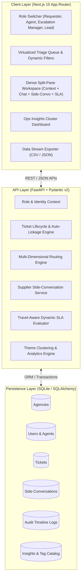

# OpsDesk - Phase 0: System Architecture & Data Schema Specification

## 1. Executive Summary & Vision
**OpsDesk** is a next-generation B2B travel operations ticketing platform architected specifically for high-velocity travel aggregators like TBO.com. In global B2B travel distribution, operational breakdowns cost millions in supplier penalties, booking cancellations, and customer churn. 

Traditional generic ticketing desks fail because they treat hotel bookings like generic software bug reports. OpsDesk introduces:
1. **Booking-Centric Linkage**: Real-time aggregation across identical booking hashes (`TBOH`) and Agency IDs to eradicate duplicate investigations for the same hotel/flight incident.
2. **Travel-Aware Dynamic SLAs**: SLA countdowns governed not just by ticket submission time, but dynamically weighted by proximity to **Check-in Date** and **Last Cancellation Date (LCD)**.
3. **Isolated Supplier Side-Conversations**: First-class threads communicating with third-party hotel beds, bedbanks, and DMCs where the recipient array remains immutably bound to the supplier thread—preventing communication loss during ticket handoffs and reassignments.
4. **Context-Aware Multi-Dimensional Routing Engine**: Automated scoring prioritizing region, traveler departure urgency (<24 hours), agent language/skill tier, and current workload.
5. **Deterministic Escalation Matrix**: One-click escalation to Escalation Managers with state transition enforcement, manager queue routing, and immutable visual audit trails.
6. **Ops Insights Engine**: Dynamic clustering of incident themes and root causes for lead operations teams to address upstream supplier and API degradation.

---

## 2. High-Level Architecture

---

## 3. Relational Database Schema Specification

The storage engine utilizes standard relational structures with strict foreign keys, indexing on operational search keys (`tboh_hash`, `agency_id`, `assigned_agent_id`, `status`), and structured JSON fields for recipient lists and audit payloads.

### 3.1 Entities & Table Schemas

#### Table: `agencies`
Represents the B2B travel agency partner (e.g., travel agency in Dubai, OTA in London, corporate travel desk in Mumbai).
* `id`: VARCHAR(36) PRIMARY KEY (UUID)
* `code`: VARCHAR(32) UNIQUE NOT NULL (e.g., `AGY-DXB-902`)
* `name`: VARCHAR(255) NOT NULL (e.g., `Emirates Horizon Holidays`)
* `tier`: VARCHAR(32) NOT NULL (Values: `PLATINUM`, `GOLD`, `SILVER`, `STANDARD`)
* `region`: VARCHAR(64) NOT NULL (Values: `EMEA`, `APAC`, `AMER`, `GLOBAL`)
* `country_code`: VARCHAR(2) NOT NULL (e.g., `AE`, `IN`, `GB`, `US`)
* `account_manager`: VARCHAR(255) NULL
* `created_at`: TIMESTAMP NOT NULL DEFAULT CURRENT_TIMESTAMP

#### Table: `users`
Represents system actors (Requester / Agency Rep, Desk Agent, Escalation Manager, Operations Lead).
* `id`: VARCHAR(36) PRIMARY KEY (UUID)
* `email`: VARCHAR(255) UNIQUE NOT NULL
* `full_name`: VARCHAR(255) NOT NULL
* `role`: VARCHAR(32) NOT NULL (Values: `REQUESTER`, `AGENT`, `ESCALATION_MANAGER`, `LEAD`)
* `region`: VARCHAR(64) NOT NULL (Values: `EMEA`, `APAC`, `AMER`, `GLOBAL`)
* `skills`: JSON NOT NULL DEFAULT '[]' (e.g., `["HOTEL", "REFUND", "ARABIC", "ESCALATION"]`)
* `availability_status`: VARCHAR(32) NOT NULL DEFAULT 'AVAILABLE' (Values: `AVAILABLE`, `BUSY`, `OFFLINE`)
* `active_ticket_count`: INTEGER NOT NULL DEFAULT 0
* `max_concurrency`: INTEGER NOT NULL DEFAULT 6
* `created_at`: TIMESTAMP NOT NULL DEFAULT CURRENT_TIMESTAMP

#### Table: `tickets`
The core entity capturing B2B travel operational issues.
* `id`: VARCHAR(36) PRIMARY KEY (UUID)
* `ticket_number`: VARCHAR(32) UNIQUE NOT NULL (e.g., `TBO-2026-1049`)
* `tboh_hash`: VARCHAR(64) NOT NULL (e.g., `TBOH-7849102-M`) - Hotel/Flight Booking identifier
* `agency_id`: VARCHAR(36) NOT NULL FOREIGN KEY REFERENCES `agencies.id`
* `requester_id`: VARCHAR(36) NULL FOREIGN KEY REFERENCES `users.id`
* `requester_email`: VARCHAR(255) NOT NULL
* `subject`: VARCHAR(255) NOT NULL
* `description`: TEXT NOT NULL
* `category`: VARCHAR(64) NOT NULL (Values: `CANCELLATION`, `AMENDMENT`, `REFUND`, `VOUCHER_ISSUE`, `SPECIAL_REQUEST`, `OVERBOOKING`, `RATE_DISCREPANCY`)
* `priority`: VARCHAR(32) NOT NULL DEFAULT 'MEDIUM' (Values: `LOW`, `MEDIUM`, `HIGH`, `URGENT`)
* `status`: VARCHAR(32) NOT NULL DEFAULT 'NEW' (Values: `NEW`, `OPEN`, `PENDING_SUPPLIER`, `ESCALATED`, `RESOLVED`, `CLOSED`)
* `check_in_date`: TIMESTAMP NOT NULL (Traveler check-in / departure date)
* `last_cancellation_date`: TIMESTAMP NULL (Hotel supplier free cancellation deadline / LCD)
* `region`: VARCHAR(64) NOT NULL (e.g., `EMEA`, `APAC`, `AMER`)
* `assigned_agent_id`: VARCHAR(36) NULL FOREIGN KEY REFERENCES `users.id`
* `routing_score`: FLOAT NOT NULL DEFAULT 0.0
* `routing_reason`: TEXT NULL (Audit rationale detailing why this agent was selected)
* `sla_status`: VARCHAR(32) NOT NULL DEFAULT 'ON_TRACK' (Values: `ON_TRACK`, `AT_RISK`, `BREACHED`)
* `sla_deadline`: TIMESTAMP NOT NULL
* `theme_tags`: JSON NOT NULL DEFAULT '[]' (e.g., `["supplier-timeout", "amendment-refusal"]`)
* `created_at`: TIMESTAMP NOT NULL DEFAULT CURRENT_TIMESTAMP
* `updated_at`: TIMESTAMP NOT NULL DEFAULT CURRENT_TIMESTAMP

#### Table: `ticket_messages`
Conversation timeline between the requester and operations agents.
* `id`: VARCHAR(36) PRIMARY KEY (UUID)
* `ticket_id`: VARCHAR(36) NOT NULL FOREIGN KEY REFERENCES `tickets.id`
* `sender_id`: VARCHAR(36) NULL FOREIGN KEY REFERENCES `users.id`
* `sender_email`: VARCHAR(255) NOT NULL
* `sender_role`: VARCHAR(32) NOT NULL (Values: `REQUESTER`, `AGENT`, `ESCALATION_MANAGER`, `LEAD`, `SYSTEM`)
* `message_type`: VARCHAR(32) NOT NULL DEFAULT 'PUBLIC' (Values: `PUBLIC`, `INTERNAL_NOTE`)
* `body`: TEXT NOT NULL
* `created_at`: TIMESTAMP NOT NULL DEFAULT CURRENT_TIMESTAMP

#### Table: `side_conversations`
Isolated supplier communication threads. Explicitly binds recipients to the conversation instance so ticket reassignments or transfers do not overwrite supplier contacts.
* `id`: VARCHAR(36) PRIMARY KEY (UUID)
* `ticket_id`: VARCHAR(36) NOT NULL FOREIGN KEY REFERENCES `tickets.id`
* `subject`: VARCHAR(255) NOT NULL
* `supplier_name`: VARCHAR(255) NOT NULL (e.g., `Hilton Dubai Al Habtoor Reservations`)
* `supplier_email`: VARCHAR(255) NOT NULL (Primary contact)
* `recipient_emails`: JSON NOT NULL DEFAULT '[]' (Explicit array of supplier and internal stakeholders preserved regardless of ticket owner)
* `status`: VARCHAR(32) NOT NULL DEFAULT 'OPEN' (Values: `OPEN`, `WAITING_ON_SUPPLIER`, `RESOLVED`)
* `created_by_agent_id`: VARCHAR(36) NOT NULL FOREIGN KEY REFERENCES `users.id`
* `created_at`: TIMESTAMP NOT NULL DEFAULT CURRENT_TIMESTAMP
* `updated_at`: TIMESTAMP NOT NULL DEFAULT CURRENT_TIMESTAMP

#### Table: `side_conversation_messages`
Messages exchanged exclusively with external suppliers within a side-conversation.
* `id`: VARCHAR(36) PRIMARY KEY (UUID)
* `side_conversation_id`: VARCHAR(36) NOT NULL FOREIGN KEY REFERENCES `side_conversations.id`
* `sender_email`: VARCHAR(255) NOT NULL
* `is_supplier_incoming`: BOOLEAN NOT NULL DEFAULT FALSE
* `body`: TEXT NOT NULL
* `created_at`: TIMESTAMP NOT NULL DEFAULT CURRENT_TIMESTAMP

#### Table: `audit_logs`
Immutable timeline record tracking every change, routing decision, escalation, and transfer.
* `id`: VARCHAR(36) PRIMARY KEY (UUID)
* `ticket_id`: VARCHAR(36) NOT NULL FOREIGN KEY REFERENCES `tickets.id`
* `actor_id`: VARCHAR(36) NULL
* `actor_name`: VARCHAR(255) NOT NULL
* `actor_role`: VARCHAR(32) NOT NULL
* `action_type`: VARCHAR(64) NOT NULL (Values: `CREATED`, `ROUTED`, `STATUS_CHANGED`, `ESCALATED`, `TRANSFERRED`, `SIDE_CONVO_CREATED`, `NOTE_ADDED`, `SLA_UPDATED`)
* `previous_state`: VARCHAR(255) NULL
* `new_state`: VARCHAR(255) NULL
* `reason`: TEXT NULL
* `created_at`: TIMESTAMP NOT NULL DEFAULT CURRENT_TIMESTAMP

---

## 4. API Contract Specifications

All API responses follow a uniform JSON structure with status codes, typed payloads, and RFC-7807 compliant error bodies.

### 4.1 Tickets & Auto-Linkage APIs
* **`GET /api/v1/tickets`**:
  - Query params: `status`, `priority`, `region`, `assigned_to`, `sla_status`, `search`, `page`, `page_size`.
  - Response: `{ "items": [TicketSummary], "total": int, "page": int, "page_size": int }`
* **`POST /api/v1/tickets`**:
  - Request: `{ "tboh_hash": str, "agency_id": str, "requester_email": str, "subject": str, "description": str, "category": str, "check_in_date": ISO8601, "last_cancellation_date": ISO8601?, "priority"?: str }`
  - Automated Behavior: Evaluates routing engine, assigns best agent, evaluates dynamic SLA, and returns `{ "ticket": TicketDetail, "routed_to": UserSummary, "routing_reason": str }`
* **`GET /api/v1/tickets/{ticket_id}`**:
  - Response: Complete ticket detail including agency details, assigned agent, dynamic SLA countdown, theme tags, and full conversation timeline.
* **`GET /api/v1/tickets/{ticket_id}/context-links`**:
  - Response: `{ "tboh_hash": str, "linked_tickets": [TicketSummary], "agency_tickets": [TicketSummary] }`
  - Enables instant side-pane correlation across all tickets sharing the same booking hash or agency.

### 4.2 Routing Engine APIs
* **`POST /api/v1/tickets/{ticket_id}/route`**:
  - Manually or automatically trigger re-routing evaluation.
  - Returns calculated agent scores and sets new assignee with audit log entry.
* **`POST /api/v1/tickets/{ticket_id}/transfer`**:
  - Request: `{ "target_agent_id": str, "reason": str }`
  - Preserves all side-conversations and historical logs.

### 4.3 Side-Conversations APIs
* **`GET /api/v1/tickets/{ticket_id}/side-conversations`**:
  - Returns all supplier threads associated with the ticket.
* **`POST /api/v1/tickets/{ticket_id}/side-conversations`**:
  - Request: `{ "supplier_name": str, "supplier_email": str, "recipient_emails": [str], "subject": str, "initial_message": str }`
  - Creates supplier thread, registers recipient list, and records system audit log.
* **`POST /api/v1/side-conversations/{side_convo_id}/messages`**:
  - Request: `{ "body": str, "is_supplier_incoming": bool }`
  - Adds message to thread; updates thread `updated_at`.

### 4.4 Dynamic SLA & Escalation APIs
* **`POST /api/v1/tickets/{ticket_id}/escalate`**:
  - Request: `{ "reason": str, "escalation_notes": str }`
  - Transitions status to `ESCALATED`, sets priority to `URGENT`, reassigns to an active `ESCALATION_MANAGER`, and writes immutable audit entry.
* **`GET /api/v1/tickets/{ticket_id}/sla`**:
  - Returns remaining seconds, deadline, urgency weight factor, and breached flag.

### 4.5 Ops Insights & Data Export APIs
* **`GET /api/v1/insights/clusters`**:
  - Returns aggregated clusters by theme tags, supplier degradation rate, and average resolution time with linked sample ticket IDs.
* **`GET /api/v1/export/tickets`**:
  - Query params: `format` (`csv` or `json`), `status`, `from_date`, `to_date`.
  - Streams full un-capped data with RFC-4180 compliance or JSON stream.

---

## 5. Role-Based Access Control (RBAC) Matrix

| Feature / Action | Requester (Agency Rep) | Desk Agent | Escalation Manager | Operations Lead |
| :--- | :---: | :---: | :---: | :---: |
| Create Ticket | **Yes** | **Yes** | **Yes** | **Yes** |
| View Own Agency Tickets | **Yes** | **Yes** | **Yes** | **Yes** |
| View All Queue Tickets | No | **Yes** | **Yes** | **Yes** |
| Post Public Reply | **Yes** | **Yes** | **Yes** | **Yes** |
| Post Internal Note | No | **Yes** | **Yes** | **Yes** |
| Launch Supplier Side-Convo | No | **Yes** | **Yes** | **Yes** |
| Escalate to Manager | No | **Yes** | **Self-Assigned** | **Yes** |
| Reassign / Force Route | No | **Yes** (Transfer) | **Yes** | **Yes** |
| View Ops Insights Dashboard | No | Read-Only | **Yes** | **Full Admin** |
| Export Operations Data | No | Read-Only (CSV) | **Yes** | **Yes** (Full) |

---

## 6. Implementation Readiness Verification
- All entities, relations, data types, and enum domains are fully bounded.
- The schema accommodates SQLite locally with zero native JSON extension dependencies (utilizing serialized text/JSON fields handled cleanly by Pydantic/SQLAlchemy).
- Transition to Phase 1 is validated.
