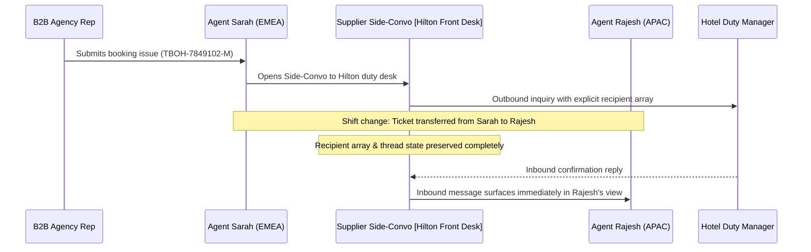

# OpsDesk - Phase 3: Side-Conversations, Travel-Aware SLAs & Escalations

## 1. Supplier Side-Conversations Architecture

### 1.1 The Decoupled Recipient Array Pattern
In traditional service desks (e.g. Zendesk, Freshdesk), external ticket side-conversations often link recipients to the parent ticket assignee or group. When an operations agent goes off-shift, takes lunch, or reassigns the ticket to a regional queue, third-party supplier replies (from hotel front desks or airline emergency desks) can bounce or get siloed in personal inboxes.

**OpsDesk Solution**:
- Every `SideConversation` has an immutable, explicit recipient list `recipient_emails` (stored as structured JSON) directly attached to the side-conversation record.
- When a ticket is reassigned or transferred, the recipient array is preserved intact.
- The new ticket owner immediately inherits the entire supplier communication history, including sent dates, supplier email headers, and pending replies.



---

## 2. Dynamic Travel-Aware SLA Engine

### 2.1 The Departure & LCD Paradox
Generic ticketing systems calculate SLA strictly as:
`Deadline = Ticket_Created_At + Fixed_SLA_Hours (e.g., 4 hours)`

In B2B travel operations, this creates catastrophic failures:
- A ticket submitted 2 hours before hotel check-in would be given a 4-hour SLA—resulting in the guest arriving before the ticket is even reviewed!
- A ticket for free cancellation submitted 30 minutes before the hotel's **Last Cancellation Date (LCD)** would breach the LCD, forcing the agency to pay full penalty charges.

### 2.2 OpsDesk Dynamic Travel-Aware SLA Formulation
OpsDesk dynamically evaluates SLA deadlines using:

```
Target_Deadline = MIN(
    Created_At + Base_Category_SLA,
    Check_In_Date - Safety_Margin_Checkin,
    Last_Cancellation_Date - Safety_Margin_LCD
)
```

Where:
- `Safety_Margin_Checkin`:
  - If Check-in `< 24 hours`: Margin is 45 minutes prior to check-in.
  - If Check-in `< 6 hours`: Margin is 15 minutes prior to check-in (immediate escalation).
- `Safety_Margin_LCD`: 30 minutes prior to Last Cancellation Date.
- `Base_Category_SLA`:
  - `URGENT`: 1 hour
  - `HIGH`: 2 hours
  - `MEDIUM`: 4 hours
  - `LOW`: 8 hours

### 2.3 Real-Time Status Computation
The SLA status is continuously evaluated:
- **`ON_TRACK`**: `Remaining_Seconds > 3600` (More than 1 hour remains)
- **`AT_RISK`**: `0 < Remaining_Seconds <= 3600` (Less than 1 hour remains)
- **`BREACHED`**: `Remaining_Seconds <= 0` (Deadline has passed)

---

## 3. First-Class Escalation Matrix

### 3.1 One-Click Escalation to Escalation Manager
When an agent encounters a blocked supplier, impending SLA breach, or VIP Platinum agency dispute, they execute the **"Escalate to Escalation Manager"** action.

1. **State Mutation**:
   - `ticket.status` -> `ESCALATED`
   - `ticket.priority` -> `URGENT`
   - `ticket.assigned_agent_id` -> Reassigned to an active user with role `ESCALATION_MANAGER` (e.g., Priya Nair).
2. **Audit Timeline Insertion**:
   - Creates an immutable `AuditLog` entry documenting the previous owner, new manager, escalation reason, and timestamp.
3. **Manager Triage Queue Notification**:
   - Ticket surfaces at the top of the Escalation Manager's workspace with a flashing amber/red badge.
